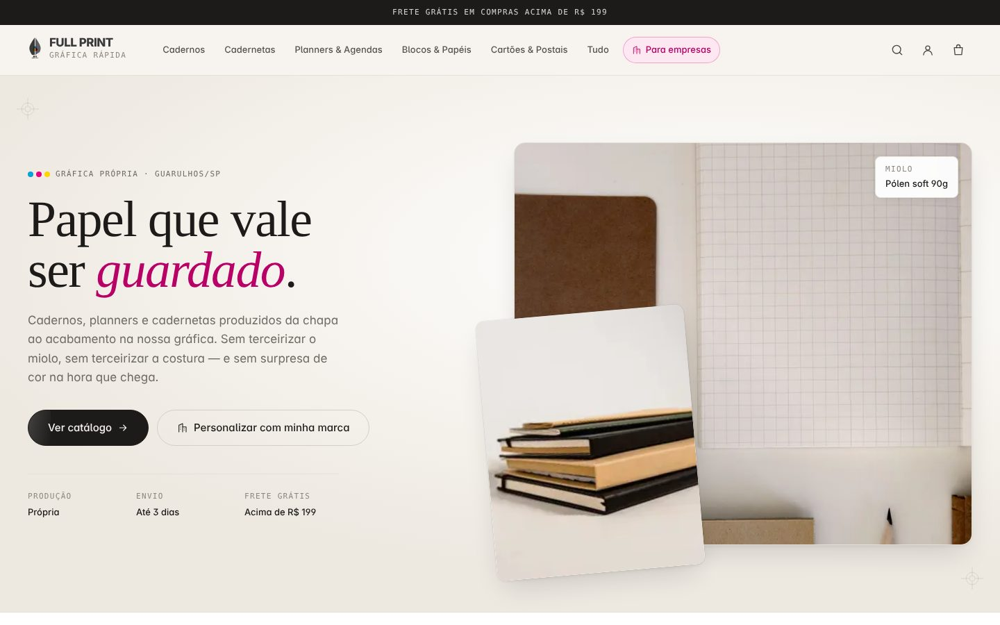

# Full Print — Loja e painel

Protótipo da loja virtual e do painel administrativo da Full Print, gráfica de Guarulhos/SP.
Front-end prototype of the online store and admin panel for Full Print, a print shop in Guarulhos, Brazil.

[🇧🇷 Português](#-português) · [🇺🇸 English](#-english)

<p align="center">
  
  
</p>

---

## 🇧🇷 Português

Protótipo de front-end da loja virtual e do painel administrativo da **Full
Print**, gráfica do Marcel de Araújo em Guarulhos/SP. Feito para apresentação:
navega inteiro, mas não tem banco de dados, autenticação nem integração.

Next.js 16 · React 19 · TypeScript · Tailwind 4. Sem backend e sem variável de
ambiente — `npm install && npm run dev` e está no ar.

```bash
npm install
npm run dev      # http://localhost:3000
npm run build && npm start   # build de produção, mais fiel na apresentação
```


### Roteiro de apresentação

Ordem pensada para contar a história do negócio, não para passear por telas.
Leva de 12 a 15 minutos.

**1. `/` — a loja.** Abre pela home. O argumento é produção própria: hero,
faixa das contas atendidas (Nescau, Sucrilhos), categorias, "como o produto
fica pronto". Rolar até o bloco escuro **Para empresas** — é a ponte para o
segundo motor de receita.

**2. `/produtos` — catálogo.** Mexer nos filtros ao vivo: marcar *Cadernos*,
depois *Personalizável com marca*. A contagem responde na hora. Ordenar por
*Mais vendidos*.

**3. `/produto/caderno-bauhaus` — página de produto.** Galeria, ficha técnica,
calculadora de frete (digitar um CEP qualquer com 8 dígitos), e o bloco azul
**Para empresa**, que leva o mesmo produto para o B2B.

**4. Carrinho e checkout.** Adicionar ao carrinho abre a gaveta lateral com a
barra de frete grátis. Seguir para `/checkout` e passar pelos três passos.
No resumo, aplicar o cupom `PRIMEIRACOMPRA` — o total recalcula.

**5. `/empresas` — o B2B.** Página do segundo motor: o que dá para
personalizar, as cinco etapas do briefing à entrega, e o formulário de
orçamento. Enviar o formulário mostra a confirmação.

**6. `/entrar` — a virada.** Aqui o cliente para de ver a loja e começa a ver o
sistema. "Acessar como Marcel" entra direto.

**7. `/painel` — dashboard.** Os quatro KPIs, receita mensal contra o ano
anterior (passar o mouse no gráfico mostra o balão), origem da venda, ranking
de produto, estoque no mínimo e funil B2B.

**8. `/painel/pedidos`.** Filtrar por *Em produção*. Abrir um pedido no ícone
de olho: a gaveta mostra a esteira, os itens e os totais.

**9. `/painel/estoque`.** Curva ABC, capital parado por categoria, e
**Nova entrada** — o modal calcula o novo saldo enquanto se digita.

**10. `/painel/b2b` — o pipeline.** Quadro por etapa. **Novo orçamento** abre o
cálculo de preço por tiragem: trocar a peça e a tiragem muda o unitário na
hora. É o argumento mais forte para o Marcel, porque é o preço do jeito que
gráfica calcula.

**11. `/painel/financeiro`.** Receita, custo e lucro nos 12 meses, para onde
vai cada real, despesas por natureza e o caixa a realizar.

**12. `/painel/relatorios`** fecha, se sobrar tempo.

#### Antes de apresentar

- Rodar `npm run build && npm start` em vez de `npm run dev` — sem o indicador
  de desenvolvimento do Next no canto e sem recompilação no meio da navegação.
- Abrir em janela anônima: o carrinho fica no `localStorage` e começa com dois
  itens de demonstração.


### O que é real e o que é encenação

**Funciona de verdade:** navegação inteira, filtros, busca (`Ctrl/⌘ K` no
painel), carrinho com persistência, cupons com regra de valor mínimo, cálculo
de preço B2B por tiragem, ordenação e paginação das tabelas, exportação em CSV
de verdade, e todos os gráficos com hover.

**É encenação:** login não autentica ninguém; frete devolve tabela fixa;
pagamento não processa; formulários não enviam nada.

**Números:** todos fictícios, gerados por PRNG com semente fixa — a mesma tela
aparece igual em toda visita. A escala foi calibrada para uma operação de porte
(~R$ 220 mil/mês, ~800 pedidos), mas **preço, prazo, gramatura e estoque não
foram confirmados com a Full Print**.

⚠️ **Fotos são de banco de imagem (Pexels)**, não são o produto real. A versão
final precisa do catálogo fotografado pela gráfica.

⚠️ **Nescau e Sucrilhos** aparecem como prova social porque são contas que o
Marcel atendeu — confirmar com ele o que pode ir a público antes de publicar.


### Próxima fase

Correios (frete e etiqueta) · Mercado Pago (Pix, cartão, boleto) · banco de
dados e autenticação de verdade · área do cliente com histórico · e as telas
marcadas como "próxima fase" dentro do painel.


### Estrutura

```
app/
  (loja)/      home, catálogo, produto, coleção, checkout, empresas, ajuda
  painel/      dashboard, pedidos, clientes, b2b, produtos, categorias,
               estoque, cupons, promoções, financeiro, relatórios, config
  entrar/      login do painel
components/
  loja/  painel/  marca/  mockup/  ui/
lib/
  catalogo.ts      44 produtos, categorias e coleções
  painel-dados.ts  pedidos, clientes, financeiro, pipeline B2B
  carrinho.tsx     Context + localStorage
  format.ts        moeda e data em pt-BR na mão (evita erro de hidratação)
scripts/
  capturar.mjs     screenshots via Chrome local (ver comentário no arquivo)
```

Contexto do cliente, identidade e decisões do projeto ficam **fora deste
repositório**, em `../FullPrint/` (workspace MazyOS).

---

## 🇺🇸 English

A front-end prototype of the online store and admin panel for **Full Print**, a print shop in Guarulhos/SP. It was built for a client presentation: you can navigate everything, but there is no database, authentication or integrations.

Next.js 16 · React 19 · TypeScript · Tailwind 4. No backend, no environment variables.

```bash
npm install
npm run dev                 # http://localhost:3000
npm run build && npm start  # production build, closer to the real thing
```

### What's inside

- **Store:** home page, catalog with live filters and sorting, product pages (gallery, specs, shipping calculator, B2B block), cart drawer with a free-shipping bar, a 3-step checkout, a page for companies (B2B quotes) and a help center.
- **Admin panel:** dashboard, orders, customers, B2B pipeline, products, categories, stock, coupons, promotions, finance, reports and settings, with global search (`Ctrl/⌘ K`).

### What's real and what's staged

**Actually works:** full navigation, filters, search, cart persistence (`localStorage`), coupons with minimum-order rules, B2B pricing by print run, table sorting and pagination, real CSV export, and interactive charts.

**Staged:** login doesn't authenticate; shipping returns a fixed table; payments aren't processed; forms don't send anything.

**Numbers:** all fictional, generated by a seeded PRNG so every visit looks the same. Prices, lead times and stock have not been confirmed with Full Print. Product photos come from a stock library (Pexels), not the real products.

### Next phase

Correios (shipping and labels) · Mercado Pago (Pix, card, boleto) · real database and authentication · customer area with order history.

### Structure

```
app/
  (loja)/      home, catalog, product, collection, checkout, companies, help
  painel/      dashboard, orders, customers, b2b, products, categories,
               stock, coupons, promotions, finance, reports, settings
  entrar/      admin login
components/    loja/ painel/ marca/ mockup/ ui/
lib/           catalog data, panel data, cart context, pt-BR formatting
scripts/       capturar.mjs, screenshots via local Chrome
```

The presentation script (step-by-step demo route) is in the Portuguese section above.
